# claude-mods

Four mods for [Claude Code](https://code.claude.com): a control panel above the prompt, replies that point at code, a side chat that draws, and an approval step before every subagent. Each one works in the terminal and in the Claude desktop app. Install them together or one at a time.

| Mod | What it does |
| --- | --- |
| [user-hud](#user-hud) | A panel above the prompt: model and effort, cache timer, context use, your other sessions, follow-up prompts. |
| [code-reference](#code-reference) | Ask about code; the answer links each claim to the lines, and a click shows them in a pane. |
| [ask](#ask) | A side chat that already knows your session. It answers in a pane and can draw diagrams. |
| [delegator](#delegator) | Every subagent Claude starts waits for your OK, then shows its progress and cost as it runs. |

## Quick start: all four mods

You need Claude Code 2.1.287 or later (`claude --version`) and Python 3.9 or later (macOS includes it).

1. In a terminal (bash or zsh), run:

   ```bash
   python3 <(curl -fsSL https://raw.githubusercontent.com/hyperbola-bear/claude-mods/main/mods)
   ```

2. Press `a` to tick every mod, then press Enter.
3. Press Enter to keep all of user-hud's modules on.
4. Press Enter to install.
5. Start a new Claude Code session.

This takes about ten seconds. Lines such as `18 userConfig options not yet set` are normal: every setting starts at its default.

## Install one mod

No Python needed. Run this in a terminal, with the mod's name in place of `code-reference`:

```bash
claude plugin install code-reference --marketplace hyperbola-bear/claude-mods
```

Then start a new Claude Code session. The names are `user-hud`, `code-reference`, `ask` and `delegator`.

## Use them

| Mod | How to use it |
| --- | --- |
| user-hud | It appears above the prompt by itself. `/hud` opens or closes the panel. Click into the panel to use its keys, such as `w` to keep the cache warm and `1`–`3` for a follow-up prompt. |
| code-reference | Type `/code-reference` and a question about the code, such as `/code-reference how does login work?`, or a PR link to review. Click a numbered box to see that code. |
| ask | Type `/ask` and a question, or `/draw` and something to draw. Press `s` in the pane to send an answer to the main chat. |
| delegator | Nothing to type. When Claude starts a subagent, pick **Approve**, **Change model** or **Refuse**. `/delegator off` turns the approvals off. |

## Change settings

1. In Claude Code, type `/plugin configure` and the mod's full name, such as `/plugin configure user-hud@polar-mods`. In the terminal, `/config` shows the same settings.
2. For user-hud, you can also click into the panel and press `s`.
3. To turn one user-hud module off, type `/hud` and the module, such as `/hud tokens off`. `/hud modules` lists them all.

Every setting is listed in [All settings](#all-settings) below.

## Update or remove

- **Update every mod:** run `python3 ~/.claude/plugins/marketplaces/polar-mods/mods --update`. With user-hud installed, you can type `/user-hud:update-mods` in Claude Code instead.
- **Add or remove mods:** run the quick-start command again and change the ticks. Unticked mods are removed.
- **Remove one mod:** run `claude plugin uninstall ask@polar-mods`, with the mod's name in place of `ask`.

Changes load in the next Claude Code session.

## The mods

### user-hud

A panel above the prompt, made of seven modules. Each is on by default, and `/hud <module> off` turns one off. Click the tab, or type `/hud`, to open or close the panel.

- **Model and effort:** pickers for the model and the effort level.
- **Cache:** the prompt cache countdown, Keep warm, and an alert before the cache expires.
- **Context:** how full the context is, and where the tokens went.
- **Sessions:** your other Claude Code sessions, and which of them need you.
- **Check my guesses:** the guesses Claude acts on, for you to mark right or wrong.
- **Next steps:** up to three follow-up prompts after each reply.
- **Handoff:** write a handoff note for the next session, or read the newest one.

Each module at work:

**Model and effort.** Click a model or an effort level to switch to it.

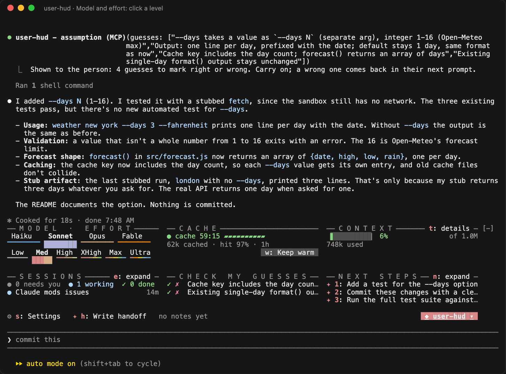

**Cache.** A countdown of the prompt cache's life, with **Keep warm** (`w`) to reset it. When 2 minutes are left, user-hud alerts you once. By default that is a macOS alert with its own **Keep warm** button, so you see it from any app:

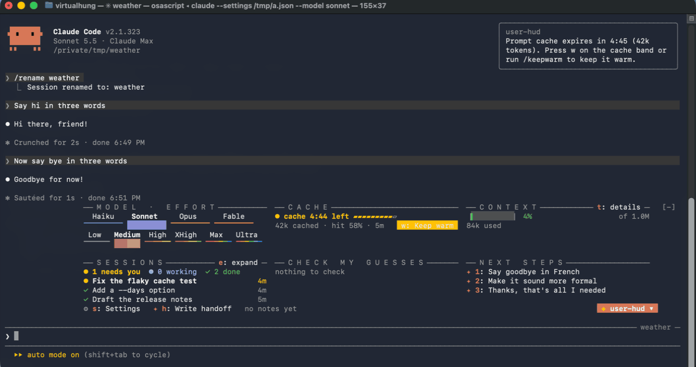

With **macOS alert** off, you get only the notice in Claude Code, and Keep warm stays one press away beside the countdown:

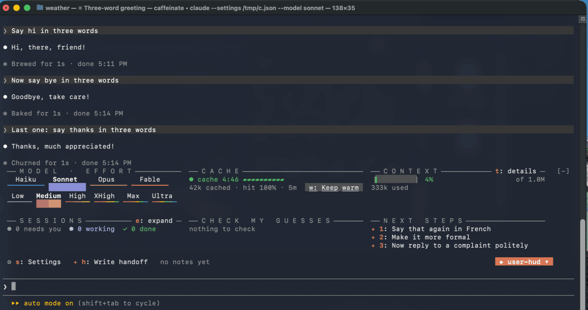

These two clips were recorded on a Mac with a 5-minute cache and the alert at 4:45. By default the countdown follows your cache's lifetime, and the alert comes with 2 minutes left.

**Context.** How full the context is. `t` opens where the tokens went, by group; click a group to see what is in it.

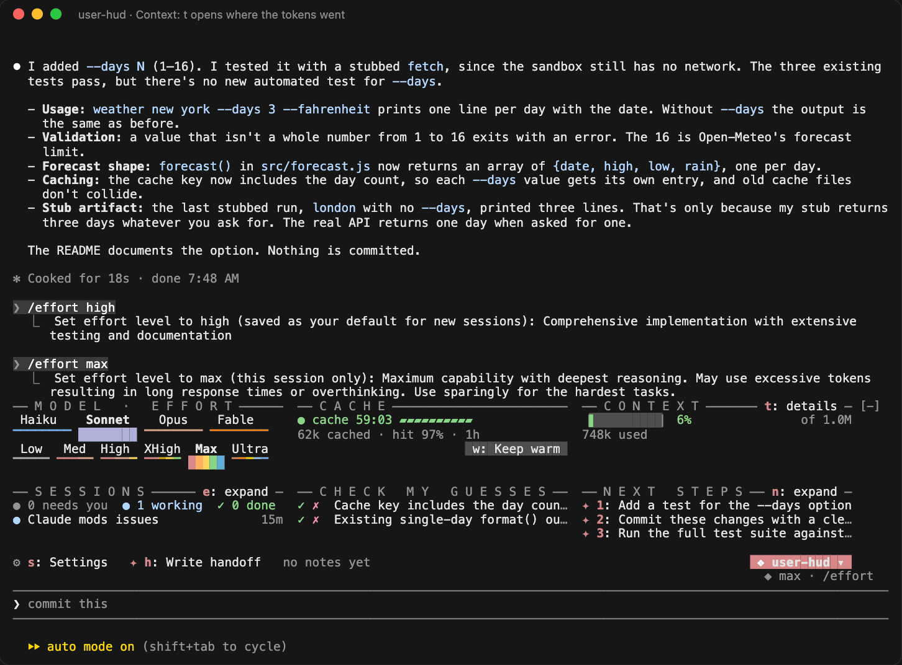

**Sessions.** Your other Claude Code sessions: which need you (yellow), which are working (blue) and which are done (green). **e: expand**, or `/sessions`, lists them all in a pane, and a click on one takes you to it: its terminal tab, its tmux pane, or its window in the desktop app.

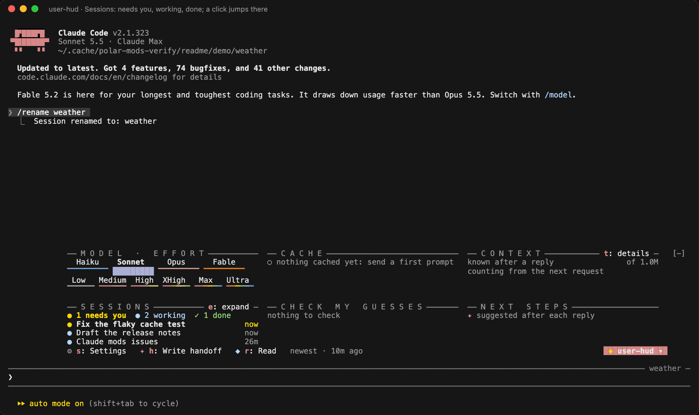

**Check my guesses.** When Claude fills in something you did not say, the guess shows here. `✓` marks it right. `✗` puts `Not quite:` and the guess in the prompt box for you to correct. **g: expand** shows every guess in full across the panel, as `n` does for next steps.

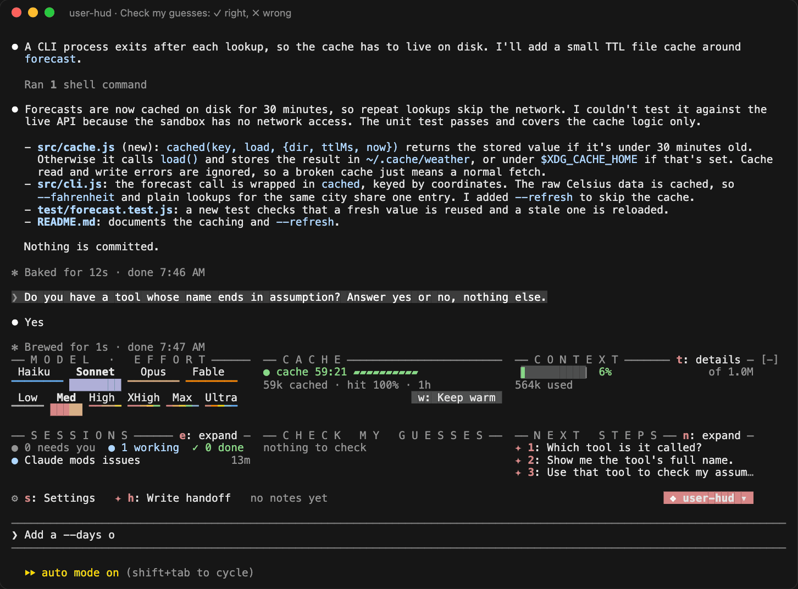

**Next steps.** After each reply, up to three follow-up prompts; `1`, `2` or `3` puts one in the prompt box. **n: expand** shows them in full.

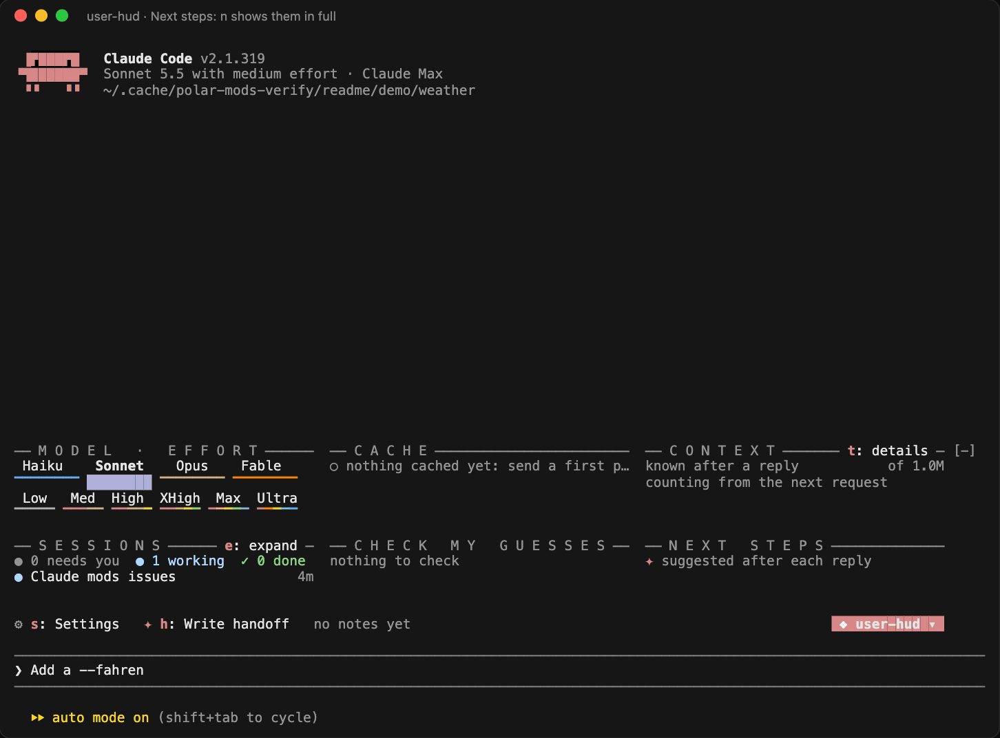

**Handoff.** `h` has Claude write a handoff note for the next session; `r` opens the newest one.

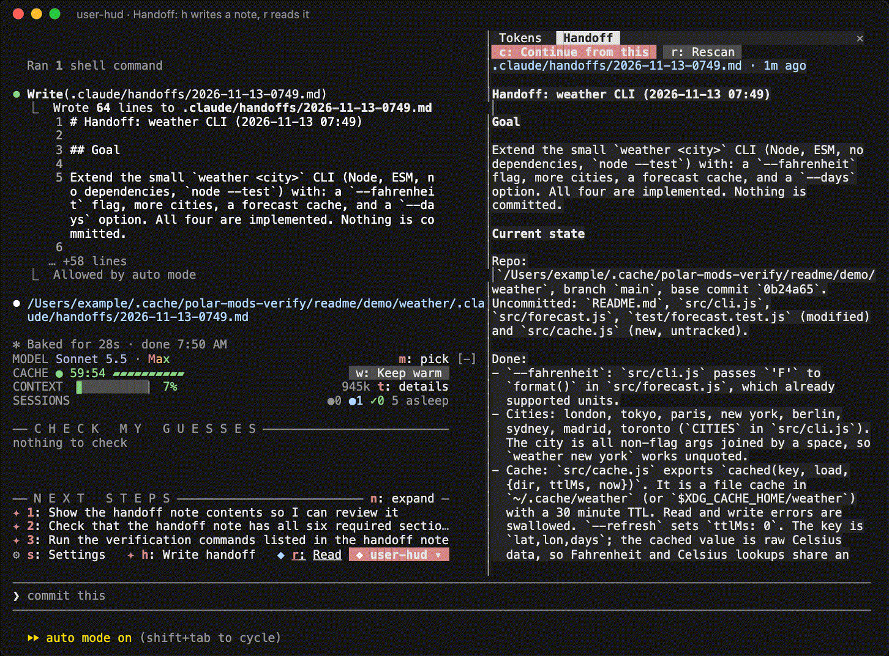

More in [plugins/user-hud](plugins/user-hud/README.md).

### code-reference

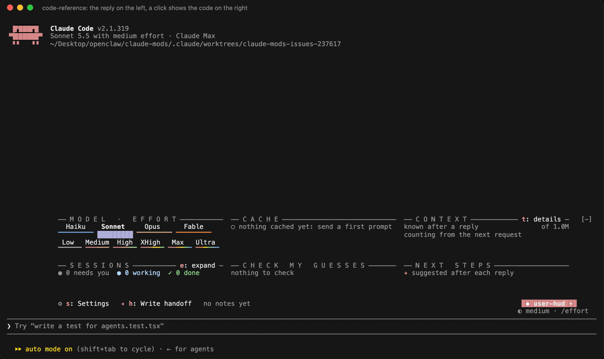

Ask with `/code-reference` and the answer comes back as short sections. Each linked word has a number, and the boxes under each section name the file and lines. Click a box, or press `a` and `d` in the pane, to read that code. Long lines fold so the line numbers still match the file. Give it a GitHub PR link and it reviews the PR the same way.

Press `e` in the pane to open the code in your editor. When the terminal is too narrow for a pane, the code shows in a box under the section instead.

More in [plugins/code-reference](plugins/code-reference/README.md).

### ask

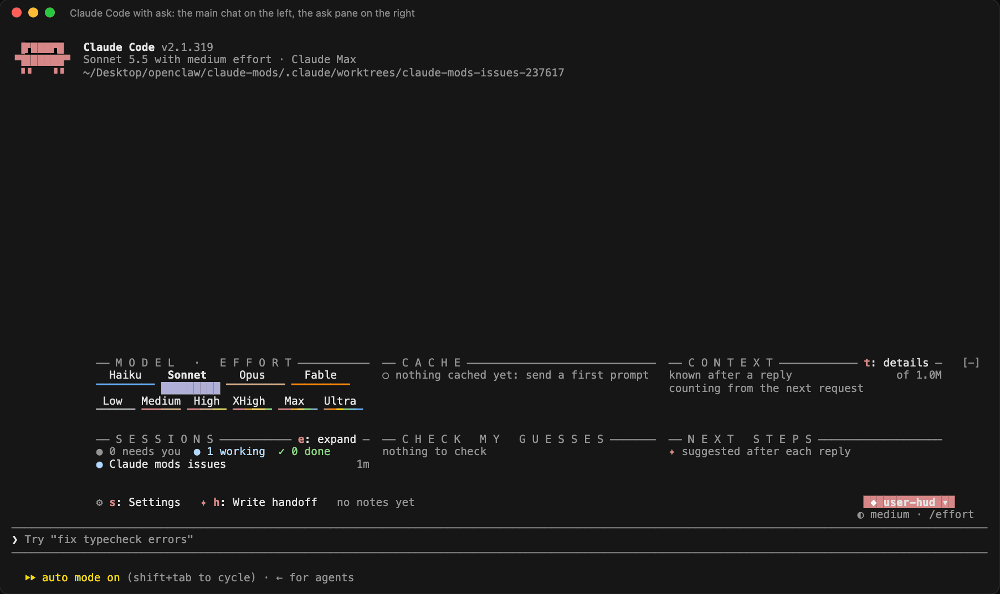

A side chat in a pane. Each question goes to a copy of the main chat, so the answer knows your whole session, and nothing is added to the main chat unless you press `s`. `/draw` answers with a diagram: box characters in the terminal, a picture in the desktop app. `/ask-rewind` takes back the newest question and answer.

More in [plugins/ask](plugins/ask/README.md).

### delegator

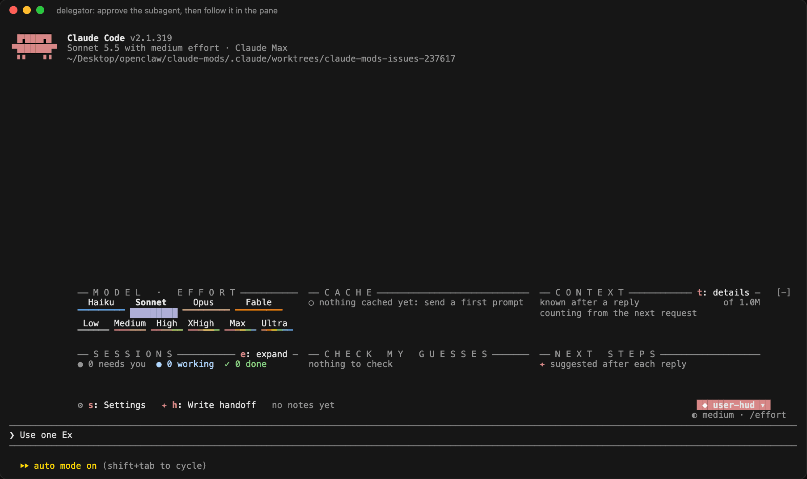

When Claude starts a subagent, it waits for you. You see its task and the model it would use, and you choose **Approve**, **Approve all this turn**, **Change model** or **Refuse**. You can also type a note to add to its task. When Claude names no model, the delegator suggests one: Haiku for lookups, Sonnet for building, Opus for design.

The Delegator pane then follows each agent: its context, tokens, estimated cost, time and the step it is on.

More in [plugins/delegator](plugins/delegator/README.md).

## Known issues

- **Start a new session after installing.** Mods load when a session starts.
- **Narrow windows show less.** Below about 40 columns, user-hud shows only its tab. Below 144 columns, a pane opened by a click in the panel waits until you type its command once (`/sessions`, `/tokens`, `/read-handoff`, `/hud-styles`, `/hud modules`); after that, the click opens it from 110 columns. code-reference opens its pane only when the window is wide enough; otherwise the code shows under the section.
- **The VS Code extension and the mobile app draw no panels.** There the mods show plain text and buttons instead.
- **On the desktop app, `/config` has no plugin settings.** Use `/plugin configure <mod>@polar-mods`, or user-hud's `s` key. `/delegator on` and `off` there need `claude` on your PATH.
- **Some links don't open at the line.** Cmd-click opens a code-reference link at the line in VS Code, Cursor, Windsurf and JetBrains terminals. Elsewhere it opens the file, unless **Editor command** names `code`, `cursor` or `windsurf`.
- **macOS only:** user-hud's cache alert and its sound.
- **These cost tokens:** each `/ask` question reads the main chat (billed at the cheaper cache-read rate); next steps make one short Haiku call per reply; automatic keep-warm pings, when you turn them on, are billed as cache reads.
- **delegator waits for you.** Every subagent waits until you answer. Use **Approve all this turn**, or `/delegator off`. Turning it off doesn't release agents that are already waiting.

## All settings

Change these with `/plugin configure <mod>@polar-mods` or `/config`. The names below are the names shown there.

### user-hud

| Setting | Default | What it does |
| --- | --- | --- |
| Module: cache | on | Cache timer, Keep warm, the expiry alerts, `/cache`, `/keepwarm`. |
| Module: pickers | on | Model and effort pickers, `/hud-styles`. |
| Module: tokens | on | Context battery, where tokens went, `/tokens`. |
| Module: sessions | on | Your other sessions on this machine, `/sessions`. |
| Module: guesses | on | Guesses for you to mark right or wrong. |
| Module: next steps | on | Up to three follow-up prompts after each reply (one short Haiku call). |
| Module: handoff | on | Write and read handoff notes, `/read-handoff`. |
| Module order | pickers, cache, tokens, sessions, assume, next, handoff | The order of the cards. |
| Kept open | next | Cards that never fold when the panel is short of rows. |
| Show the corner panel above the prompt | on | Off hides the panel and its tab. |
| Picker style | rail | How the pickers look: `rail`, `ladder` or `meter`. `/hud-styles` shows all three. |
| Alert when this many seconds are left | 120 | When the cache alert fires. |
| macOS alert | on | Also show a macOS alert with a Keep warm button. |
| macOS alert stays (seconds) | 7 | How long the macOS alert stays. |
| Alert sound | on | Play a sound with the alert. |
| Keep the cache warm automatically | off | Ping the cache 30 seconds before it expires. Each ping is billed as a cache read. |
| Automatic pings per idle stretch | 3 | The most automatic pings between two of your prompts. |
| Handoff note location | (empty) | Where handoff notes live. Empty searches `HANDOFF.md`, `.claude/`, `.claude/handoffs/`, `handoffs/` and `docs/`. |

### code-reference

| Setting | Default | What it does |
| --- | --- | --- |
| Editor command | (empty) | The editor that opens code at a line: `code`, `cursor`, `zed`, `idea`, `goland` and so on. Empty finds the editor you run Claude Code in. |
| gh executable | gh | The GitHub CLI used to read pull requests. Without it, a GitHub MCP server or plain git is used. |
| Offer to install what it can use | on | After install, ask once about the GitHub CLI, Ghostty and terminal-browser. `/code-reference-setup` asks again. |

### ask

| Setting | Default | What it does |
| --- | --- | --- |
| Model before the first turn | haiku | Answers questions asked before the session's first reply. After that, the session's own model answers. |
| Questions kept in the pane | 30 | Older questions scroll away. |

### delegator

| Setting | Default | What it does |
| --- | --- | --- |
| Approve subagents before launch | on | Off, subagents start without asking. `/delegator on` and `/delegator off` change it too. |
| Suggest a model by task complexity | on | When Claude names no model: Haiku for lookups, Sonnet for building, Opus for design. |
| Show the characters | on | A pixel character beside each running agent. |
| Animate the characters | on | The characters move while their agent runs. |
| Ask agents to report their steps | on | Adds one line to each agent's task so it reports its steps to the pane. |

### The `mods` script

Once the marketplace is added, the script is also on disk at `~/.claude/plugins/marketplaces/polar-mods/mods`.

| Option | What it does |
| --- | --- |
| (none) | The checklist: install, update and remove mods, and pick user-hud's modules. |
| `--update` | Update every mod you have, with no questions. |
| `--list` | Show each mod's state and the newest version. It adds the marketplace if needed and changes nothing else. |
| `--dry-run` | Show the `claude plugin` commands instead of running them. |

If you keep delegator and have savvy-progress turned on, the script offers to turn savvy-progress off, because both track the same agents. `claude plugin enable savvy-progress@claude-kit` turns it back on.

### Install by hand

```bash
claude plugin marketplace add hyperbola-bear/claude-mods
claude plugin install user-hud@polar-mods
```

To update: `claude plugin marketplace update polar-mods`, then `claude plugin update <mod>@polar-mods`.

Two mods were renamed: user-hud was `user-hd` before 1.2.0, and code-reference was `pr-review-ui` before 2.0.0. The `mods` script replaces an old install with the new name.

## Develop

Each mod has its own tests:

```bash
claude plugin validate plugins/user-hud && claude plugin test plugins/user-hud
claude plugin validate plugins/code-reference && claude plugin test plugins/code-reference
claude plugin validate plugins/ask && claude plugin test plugins/ask
claude plugin validate plugins/delegator && claude plugin test plugins/delegator
```

Tests don't show what a person sees. To drive a mod in a real Claude Code session and check that the terminal and the desktop app draw the same rows at every width, use the `verify` skill in [.claude/skills/verify](.claude/skills/verify/SKILL.md).
